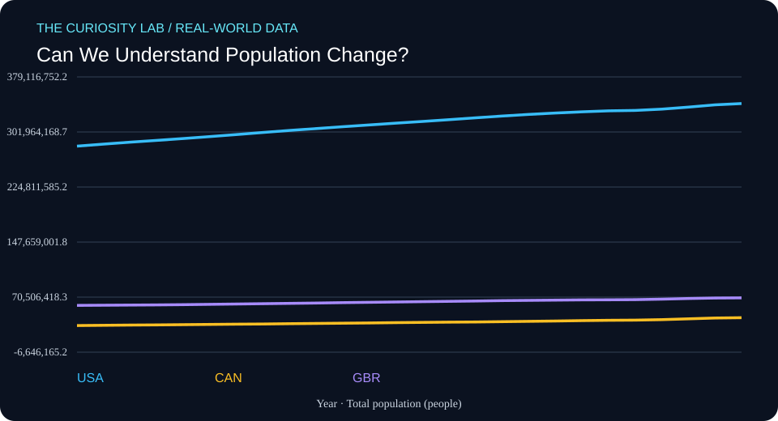

# Can We Understand Population Change?



**Field:** Data Science × Computational Demography  
**Date generated:** 2026-11-02  
**Evidence type:** Published statistical observations  
**Data provider:** World Bank  
**Literature index:** NCBI PubMed

## Research question

How have national population estimates changed over time?

## Why this matters

This project investigates a measurable, real-world pattern using
published observations rather than simulated participant data.

## Data provenance

- **Indicator:** SP.POP.TOTL
- **Measurement:** Total population (people)
- **Countries:** United States, Canada, United Kingdom
- **Observation years requested:** 2000–2025
- **Retrieved (UTC):** 2026-11-02T04:44:19.032036+00:00
- **Original API response:** https://api.worldbank.org/v2/country/USA;CAN;GBR/indicator/SP.POP.TOTL?format=json&per_page=1000&date=2000:2025
- **Indicator metadata:** https://api.worldbank.org/v2/indicator/SP.POP.TOTL?format=json

Missing values were omitted. No values were interpolated or fabricated.

## Descriptive results

| Country | First year | Last year | First value | Last value | Change |
|---|---:|---:|---:|---:|---:|
| USA | 2000 | 2025 | 282,162,411.00 | 341,784,857.00 | +59,622,446.00 |
| CAN | 2000 | 2025 | 30,685,730.00 | 41,651,653.00 | +10,965,923.00 |
| GBR | 2000 | 2025 | 58,892,514.00 | 69,487,000.00 | +10,594,486.00 |

These are differences between each country's first and last
available observations in the requested period. Countries may
have different coverage dates.

The change is expressed in the indicator's own units, not
automatically as a percentage change.

## Related research from PubMed

**Search query:** `population demographic change public health review`

**Search endpoint:** https://eutils.ncbi.nlm.nih.gov/entrez/eutils/esearch.fcgi?db=pubmed&term=population+demographic+change+public+health+review&retmax=5&retmode=json&sort=relevance&tool=curiosity_lab&email=research%40example.org

- [Global prevalence of autism: A systematic review update.](https://pubmed.ncbi.nlm.nih.gov/35238171/) — Zeidan J, Fombonne E, Scorah J, Ibrahim A; Autism research : official journal of the International Society for Autism Research (2022 May). PMID: 35238171
- [Nature and health.](https://pubmed.ncbi.nlm.nih.gov/24387090/) — Hartig T, Mitchell R, de Vries S, Frumkin H; Annual review of public health (2014). PMID: 24387090
- [The menopause transition and women's health at midlife: a progress report from the Study of Women's Health Across the Nation (SWAN).](https://pubmed.ncbi.nlm.nih.gov/31568098/) — El Khoudary SR, Greendale G, Crawford SL, Avis NE; Menopause (New York, N.Y.) (2019 Oct). PMID: 31568098
- [Defining cultural competence: a practical framework for addressing racial/ethnic disparities in health and health care.](https://pubmed.ncbi.nlm.nih.gov/12815076/) — Betancourt JR, Green AR, Carrillo JE, Ananeh-Firempong O 2nd; Public health reports (Washington, D.C. : 1974) (2003 Jul-Aug). PMID: 12815076
- [Racialized Housing Discrimination and Population Health: a Scoping Review and Research Agenda.](https://pubmed.ncbi.nlm.nih.gov/37058240/) — Cross RI, Huỳnh J, Bradford NJ, Francis B; Journal of urban health : bulletin of the New York Academy of Medicine (2023 Apr). PMID: 37058240

These articles are **related literature leads**, not independently
verified support for the numerical results above.

Their titles and bibliographic metadata were retrieved from
PubMed. Full articles were not analyzed, and no claim is made
that these studies establish causality or validate this analysis.

## Reproduce the descriptive analysis

```bash
python3 analyze.py
```

## Limitations

1. This is descriptive analysis, not causal inference.
2. The World Bank may revise historical observations.
3. National statistics can use differing collection methods.
4. Missing years and unequal country coverage affect comparisons.
5. Related PubMed papers may study different populations or outcomes.
6. Data and literature are not independently peer-reviewed by
   this automation.

## Next research questions

- What explains differences between the observed trajectories?
- Are changes robust to using the same start and end years?
- What do the original indicator metadata and source notes say?
- Which related publications directly study these measurements?
- Could a more appropriate statistical model reveal uncertainty?

## Scientific integrity

This project uses real published observations, with their source
URLs recorded. It does not claim a new discovery, a causal
relationship, or original human-subject research.

Automated research preparation requires human review.
