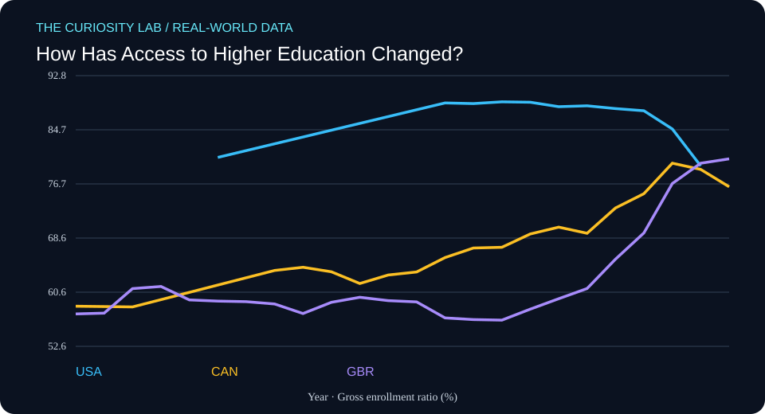

# How Has Access to Higher Education Changed?



**Field:** Cognitive Science × Education Data  
**Date generated:** 2026-11-03  
**Evidence type:** Published statistical observations  
**Data provider:** World Bank  
**Literature index:** NCBI PubMed

## Research question

How has tertiary education enrollment changed across countries?

## Why this matters

This project investigates a measurable, real-world pattern using
published observations rather than simulated participant data.

## Data provenance

- **Indicator:** SE.TER.ENRR
- **Measurement:** Gross enrollment ratio (%)
- **Countries:** United States, Canada, United Kingdom
- **Observation years requested:** 2000–2025
- **Retrieved (UTC):** 2026-11-03T09:30:37.875455+00:00
- **Original API response:** https://api.worldbank.org/v2/country/USA;CAN;GBR/indicator/SE.TER.ENRR?format=json&per_page=1000&date=2000:2025
- **Indicator metadata:** https://api.worldbank.org/v2/indicator/SE.TER.ENRR?format=json

Missing values were omitted. No values were interpolated or fabricated.

## Descriptive results

| Country | First year | Last year | First value | Last value | Change |
|---|---:|---:|---:|---:|---:|
| USA | 2005 | 2022 | 80.63 | 79.36 | -1.27 |
| CAN | 2000 | 2023 | 58.52 | 76.27 | +17.75 |
| GBR | 2000 | 2023 | 57.37 | 80.41 | +23.05 |

These are differences between each country's first and last
available observations in the requested period. Countries may
have different coverage dates.

The change is expressed in the indicator's own units, not
automatically as a percentage change.

## Related research from PubMed

**Search query:** `educational attainment cognitive development review`

**Search endpoint:** https://eutils.ncbi.nlm.nih.gov/entrez/eutils/esearch.fcgi?db=pubmed&term=educational+attainment+cognitive+development+review&retmax=5&retmode=json&sort=relevance&tool=curiosity_lab&email=research%40example.org

- [The World Federation of ADHD International Consensus Statement: 208 Evidence-based conclusions about the disorder.](https://pubmed.ncbi.nlm.nih.gov/33549739/) — Faraone SV, Banaschewski T, Coghill D, Zheng Y; Neuroscience and biobehavioral reviews (2021 Sep). PMID: 33549739
- [Examining the relationship between language development, executive function, and screen time: A systematic review.](https://pubmed.ncbi.nlm.nih.gov/39724067/) — Bal M, Kara Aydemir AG, Tepetaş Cengiz GŞ, Altındağ A; PloS one (2024). PMID: 39724067
- [Mapping global prevalence of depression among postpartum women.](https://pubmed.ncbi.nlm.nih.gov/34671011/) — Wang Z, Liu J, Shuai H, Cai Z; Translational psychiatry (2021 Oct 20). PMID: 34671011
- [Education and Cognitive Functioning Across the Life Span.](https://pubmed.ncbi.nlm.nih.gov/32772803/) — Lövdén M, Fratiglioni L, Glymour MM, Lindenberger U; Psychological science in the public interest : a journal of the American Psychological Society (2020 Aug). PMID: 32772803
- [Genome-wide association analyses identify 44 risk variants and refine the genetic architecture of major depression.](https://pubmed.ncbi.nlm.nih.gov/29700475/) — Wray NR, Ripke S, Mattheisen M, Trzaskowski M; Nature genetics (2018 May). PMID: 29700475

These articles are **related literature leads**, not independently
verified support for the numerical results above.

Their titles and bibliographic metadata were retrieved from
PubMed. Full articles were not analyzed, and no claim is made
that these studies establish causality or validate this analysis.

## Reproduce the descriptive analysis

```bash
python3 analyze.py
```

## Limitations

1. This is descriptive analysis, not causal inference.
2. The World Bank may revise historical observations.
3. National statistics can use differing collection methods.
4. Missing years and unequal country coverage affect comparisons.
5. Related PubMed papers may study different populations or outcomes.
6. Data and literature are not independently peer-reviewed by
   this automation.

## Next research questions

- What explains differences between the observed trajectories?
- Are changes robust to using the same start and end years?
- What do the original indicator metadata and source notes say?
- Which related publications directly study these measurements?
- Could a more appropriate statistical model reveal uncertainty?

## Scientific integrity

This project uses real published observations, with their source
URLs recorded. It does not claim a new discovery, a causal
relationship, or original human-subject research.

Automated research preparation requires human review.
