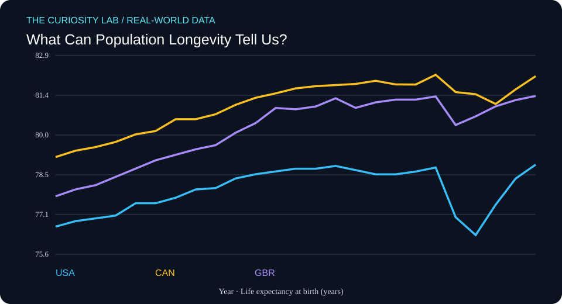

# What Can Population Longevity Tell Us?



**Field:** Cognitive Science × Public Health  
**Date generated:** 2026-11-04  
**Evidence type:** Published statistical observations  
**Data provider:** World Bank  
**Literature index:** NCBI PubMed

## Research question

How have published life-expectancy estimates changed?

## Why this matters

This project investigates a measurable, real-world pattern using
published observations rather than simulated participant data.

## Data provenance

- **Indicator:** SP.DYN.LE00.IN
- **Measurement:** Life expectancy at birth (years)
- **Countries:** United States, Canada, United Kingdom
- **Observation years requested:** 2000–2025
- **Retrieved (UTC):** 2026-11-04T09:09:11.066610+00:00
- **Original API response:** https://api.worldbank.org/v2/country/USA;CAN;GBR/indicator/SP.DYN.LE00.IN?format=json&per_page=1000&date=2000:2025
- **Indicator metadata:** https://api.worldbank.org/v2/indicator/SP.DYN.LE00.IN?format=json

Missing values were omitted. No values were interpolated or fabricated.

## Descriptive results

| Country | First year | Last year | First value | Last value | Change |
|---|---:|---:|---:|---:|---:|
| USA | 2000 | 2024 | 76.64 | 78.89 | +2.25 |
| CAN | 2000 | 2024 | 79.17 | 82.11 | +2.94 |
| GBR | 2000 | 2024 | 77.74 | 81.39 | +3.65 |

These are differences between each country's first and last
available observations in the requested period. Countries may
have different coverage dates.

The change is expressed in the indicator's own units, not
automatically as a percentage change.

## Related research from PubMed

**Search query:** `cognitive aging population health review`

**Search endpoint:** https://eutils.ncbi.nlm.nih.gov/entrez/eutils/esearch.fcgi?db=pubmed&term=cognitive+aging+population+health+review&retmax=5&retmode=json&sort=relevance&tool=curiosity_lab&email=research%40example.org

- [Type 2 Diabetes Mellitus and Cognitive Impairment.](https://pubmed.ncbi.nlm.nih.gov/34251351/) — Damanik J, Yunir E; Acta medica Indonesiana (2021 Apr). PMID: 34251351
- [Improving Cognitive Function with Nutritional Supplements in Aging: A Comprehensive Narrative Review of Clinical Studies Investigating the Effects of Vitamins, Minerals, Antioxidants, and Other Dietary Supplements.](https://pubmed.ncbi.nlm.nih.gov/38140375/) — Fekete M, Lehoczki A, Tarantini S, Fazekas-Pongor V; Nutrients (2023 Dec 15). PMID: 38140375
- [Successful aging.](https://pubmed.ncbi.nlm.nih.gov/9279031/) — Rowe JW, Kahn RL; The Gerontologist (1997 Aug). PMID: 9279031
- [Active Aging and Public Health: Evidence, Implications, and Opportunities.](https://pubmed.ncbi.nlm.nih.gov/34910580/) — Dogra S, Dunstan DW, Sugiyama T, Stathi A; Annual review of public health (2022 Apr 5). PMID: 34910580
- [Nicotinamide mononucleotide (NMN) as an anti-aging health product - Promises and safety concerns.](https://pubmed.ncbi.nlm.nih.gov/35499054/) — Nadeeshani H, Li J, Ying T, Zhang B; Journal of advanced research (2022 Mar). PMID: 35499054

These articles are **related literature leads**, not independently
verified support for the numerical results above.

Their titles and bibliographic metadata were retrieved from
PubMed. Full articles were not analyzed, and no claim is made
that these studies establish causality or validate this analysis.

## Reproduce the descriptive analysis

```bash
python3 analyze.py
```

## Limitations

1. This is descriptive analysis, not causal inference.
2. The World Bank may revise historical observations.
3. National statistics can use differing collection methods.
4. Missing years and unequal country coverage affect comparisons.
5. Related PubMed papers may study different populations or outcomes.
6. Data and literature are not independently peer-reviewed by
   this automation.

## Next research questions

- What explains differences between the observed trajectories?
- Are changes robust to using the same start and end years?
- What do the original indicator metadata and source notes say?
- Which related publications directly study these measurements?
- Could a more appropriate statistical model reveal uncertainty?

## Scientific integrity

This project uses real published observations, with their source
URLs recorded. It does not claim a new discovery, a causal
relationship, or original human-subject research.

Automated research preparation requires human review.
