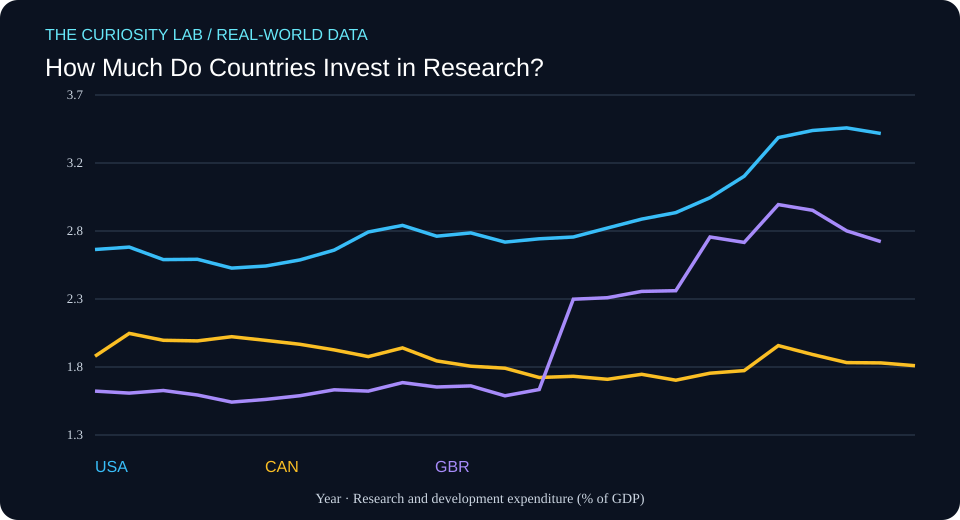

# How Much Do Countries Invest in Research?



**Field:** Computer Science × Innovation  
**Date generated:** 2026-11-06  
**Evidence type:** Published statistical observations  
**Data provider:** World Bank  
**Literature index:** NCBI PubMed

## Research question

How has research and development expenditure evolved?

## Why this matters

This project investigates a measurable, real-world pattern using
published observations rather than simulated participant data.

## Data provenance

- **Indicator:** GB.XPD.RSDV.GD.ZS
- **Measurement:** Research and development expenditure (% of GDP)
- **Countries:** United States, Canada, United Kingdom
- **Observation years requested:** 2000–2025
- **Retrieved (UTC):** 2026-11-06T09:21:58.061819+00:00
- **Original API response:** https://api.worldbank.org/v2/country/USA;CAN;GBR/indicator/GB.XPD.RSDV.GD.ZS?format=json&per_page=1000&date=2000:2025
- **Indicator metadata:** https://api.worldbank.org/v2/indicator/GB.XPD.RSDV.GD.ZS?format=json

Missing values were omitted. No values were interpolated or fabricated.

## Descriptive results

| Country | First year | Last year | First value | Last value | Change |
|---|---:|---:|---:|---:|---:|
| USA | 2000 | 2023 | 2.62 | 3.45 | +0.83 |
| CAN | 2000 | 2024 | 1.86 | 1.79 | -0.07 |
| GBR | 2000 | 2023 | 1.61 | 2.68 | +1.07 |

These are differences between each country's first and last
available observations in the requested period. Countries may
have different coverage dates.

The change is expressed in the indicator's own units, not
automatically as a percentage change.

## Related research from PubMed

**Search query:** `scientific innovation research productivity review`

**Search endpoint:** https://eutils.ncbi.nlm.nih.gov/entrez/eutils/esearch.fcgi?db=pubmed&term=scientific+innovation+research+productivity+review&retmax=5&retmode=json&sort=relevance&tool=curiosity_lab&email=research%40example.org

- [Lessons learned from the fate of AstraZeneca's drug pipeline: a five-dimensional framework.](https://pubmed.ncbi.nlm.nih.gov/24833294/) — Cook D, Brown D, Alexander R, March R; Nature reviews. Drug discovery (2014 Jun). PMID: 24833294
- [How to improve R&D productivity: the pharmaceutical industry's grand challenge.](https://pubmed.ncbi.nlm.nih.gov/20168317/) — Paul SM, Mytelka DS, Dunwiddie CT, Persinger CC; Nature reviews. Drug discovery (2010 Mar). PMID: 20168317
- [A Systematic Review of the Benefits of Hiring People with Disabilities.](https://pubmed.ncbi.nlm.nih.gov/29392591/) — Lindsay S, Cagliostro E, Albarico M, Mortaji N; Journal of occupational rehabilitation (2018 Dec). PMID: 29392591
- [Knowledge translation of research findings.](https://pubmed.ncbi.nlm.nih.gov/22651257/) — Grimshaw JM, Eccles MP, Lavis JN, Hill SJ; Implementation science : IS (2012 May 31). PMID: 22651257
- [Avoidable waste in the production and reporting of research evidence.](https://pubmed.ncbi.nlm.nih.gov/19525005/) — Chalmers I, Glasziou P; Lancet (London, England) (2009 Jul 4). PMID: 19525005

These articles are **related literature leads**, not independently
verified support for the numerical results above.

Their titles and bibliographic metadata were retrieved from
PubMed. Full articles were not analyzed, and no claim is made
that these studies establish causality or validate this analysis.

## Reproduce the descriptive analysis

```bash
python3 analyze.py
```

## Limitations

1. This is descriptive analysis, not causal inference.
2. The World Bank may revise historical observations.
3. National statistics can use differing collection methods.
4. Missing years and unequal country coverage affect comparisons.
5. Related PubMed papers may study different populations or outcomes.
6. Data and literature are not independently peer-reviewed by
   this automation.

## Next research questions

- What explains differences between the observed trajectories?
- Are changes robust to using the same start and end years?
- What do the original indicator metadata and source notes say?
- Which related publications directly study these measurements?
- Could a more appropriate statistical model reveal uncertainty?

## Scientific integrity

This project uses real published observations, with their source
URLs recorded. It does not claim a new discovery, a causal
relationship, or original human-subject research.

Automated research preparation requires human review.
