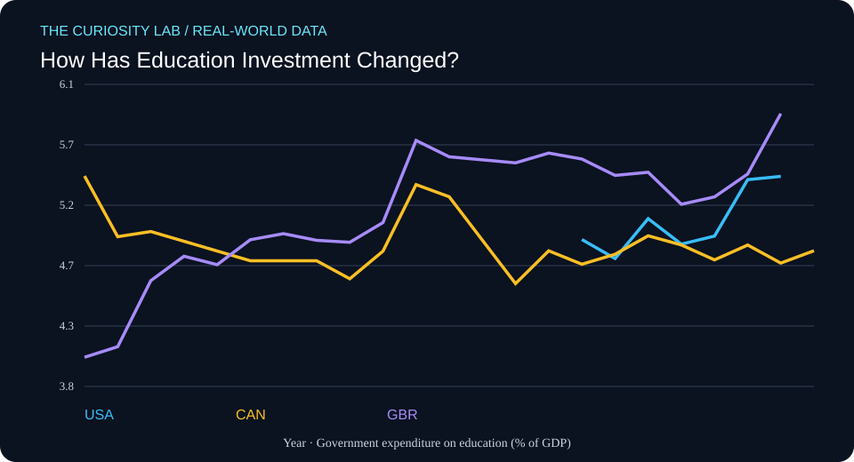

# How Has Education Investment Changed?



**Field:** Data Science × Education  
**Date generated:** 2026-11-07  
**Evidence type:** Published statistical observations  
**Data provider:** World Bank  
**Literature index:** NCBI PubMed

## Research question

How has government spending on education changed?

## Why this matters

This project investigates a measurable, real-world pattern using
published observations rather than simulated participant data.

## Data provenance

- **Indicator:** SE.XPD.TOTL.GD.ZS
- **Measurement:** Government expenditure on education (% of GDP)
- **Countries:** United States, Canada, United Kingdom
- **Observation years requested:** 2000–2025
- **Retrieved (UTC):** 2026-11-07T08:45:36.267043+00:00
- **Original API response:** https://api.worldbank.org/v2/country/USA;CAN;GBR/indicator/SE.XPD.TOTL.GD.ZS?format=json&per_page=1000&date=2000:2025
- **Indicator metadata:** https://api.worldbank.org/v2/indicator/SE.XPD.TOTL.GD.ZS?format=json

Missing values were omitted. No values were interpolated or fabricated.

## Descriptive results

| Country | First year | Last year | First value | Last value | Change |
|---|---:|---:|---:|---:|---:|
| USA | 2015 | 2021 | 4.93 | 5.42 | +0.49 |
| CAN | 2000 | 2022 | 5.42 | 4.84 | -0.58 |
| GBR | 2000 | 2021 | 4.02 | 5.91 | +1.89 |

These are differences between each country's first and last
available observations in the requested period. Countries may
have different coverage dates.

The change is expressed in the indicator's own units, not
automatically as a percentage change.

## Related research from PubMed

**Search query:** `education investment learning outcomes review`

**Search endpoint:** https://eutils.ncbi.nlm.nih.gov/entrez/eutils/esearch.fcgi?db=pubmed&term=education+investment+learning+outcomes+review&retmax=5&retmode=json&sort=relevance&tool=curiosity_lab&email=research%40example.org

- [The impact of simulation-based training in medical education: A review.](https://pubmed.ncbi.nlm.nih.gov/38968472/) — Elendu C, Amaechi DC, Okatta AU, Amaechi EC; Medicine (2024 Jul 5). PMID: 38968472
- [Burden of 375 diseases and injuries, risk-attributable burden of 88 risk factors, and healthy life expectancy in 204 countries and territories, including 660 subnational locations, 1990-2023: a systematic analysis for the Global Burden of Disease Study 2023.](https://pubmed.ncbi.nlm.nih.gov/41092926/) — GBD 2023 Disease and Injury and Risk Factor Collaborators; Lancet (London, England) (2025 Oct 18). PMID: 41092926
- [Traumatic brain injury: progress and challenges in prevention, clinical care, and research.](https://pubmed.ncbi.nlm.nih.gov/36183712/) — Maas AIR, Menon DK, Manley GT, Abrams M; The Lancet. Neurology (2022 Nov). PMID: 36183712
- [Benefits and harms of ADHD interventions: umbrella review and platform for shared decision making.](https://pubmed.ncbi.nlm.nih.gov/41297970/) — Gosling CJ, Garcia-Argibay M, De Prisco M, Arrondo G; BMJ (Clinical research ed.) (2025 Nov 26). PMID: 41297970
- [The 2024 report of the Lancet Countdown on health and climate change: facing record-breaking threats from delayed action.](https://pubmed.ncbi.nlm.nih.gov/39488222/) — Romanello M, Walawender M, Hsu SC, Moskeland A; Lancet (London, England) (2024 Nov 9). PMID: 39488222

These articles are **related literature leads**, not independently
verified support for the numerical results above.

Their titles and bibliographic metadata were retrieved from
PubMed. Full articles were not analyzed, and no claim is made
that these studies establish causality or validate this analysis.

## Reproduce the descriptive analysis

```bash
python3 analyze.py
```

## Limitations

1. This is descriptive analysis, not causal inference.
2. The World Bank may revise historical observations.
3. National statistics can use differing collection methods.
4. Missing years and unequal country coverage affect comparisons.
5. Related PubMed papers may study different populations or outcomes.
6. Data and literature are not independently peer-reviewed by
   this automation.

## Next research questions

- What explains differences between the observed trajectories?
- Are changes robust to using the same start and end years?
- What do the original indicator metadata and source notes say?
- Which related publications directly study these measurements?
- Could a more appropriate statistical model reveal uncertainty?

## Scientific integrity

This project uses real published observations, with their source
URLs recorded. It does not claim a new discovery, a causal
relationship, or original human-subject research.

Automated research preparation requires human review.
