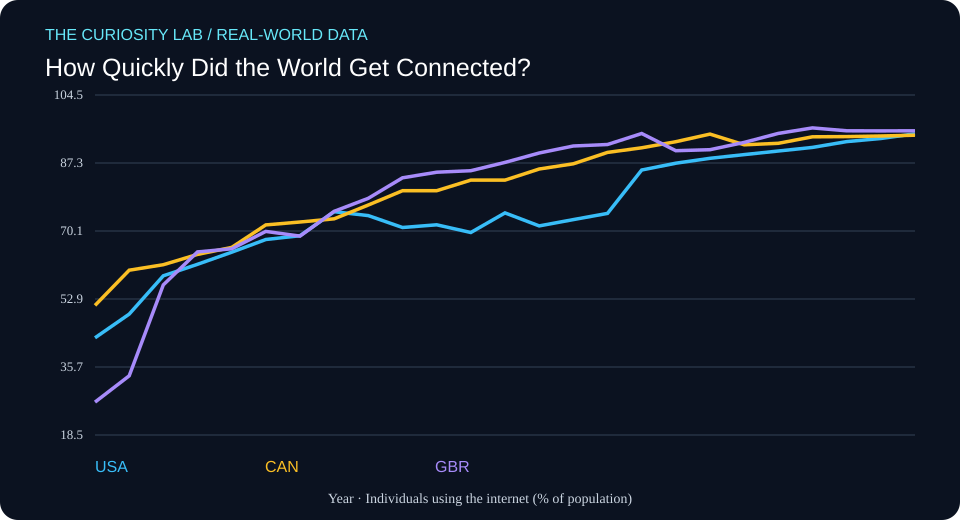

# How Quickly Did the World Get Connected?



**Field:** Computer Science × Data Science  
**Date generated:** 2026-11-11  
**Evidence type:** Published statistical observations  
**Data provider:** World Bank  
**Literature index:** NCBI PubMed

## Research question

How has internet adoption changed across countries?

## Why this matters

This project investigates a measurable, real-world pattern using
published observations rather than simulated participant data.

## Data provenance

- **Indicator:** IT.NET.USER.ZS
- **Measurement:** Individuals using the internet (% of population)
- **Countries:** United States, Canada, United Kingdom
- **Observation years requested:** 2000–2025
- **Retrieved (UTC):** 2026-11-11T09:21:49.542489+00:00
- **Original API response:** https://api.worldbank.org/v2/country/USA;CAN;GBR/indicator/IT.NET.USER.ZS?format=json&per_page=1000&date=2000:2025
- **Indicator metadata:** https://api.worldbank.org/v2/indicator/IT.NET.USER.ZS?format=json

Missing values were omitted. No values were interpolated or fabricated.

## Descriptive results

| Country | First year | Last year | First value | Last value | Change |
|---|---:|---:|---:|---:|---:|
| USA | 2000 | 2024 | 43.08 | 94.69 | +51.61 |
| CAN | 2000 | 2024 | 51.30 | 94.35 | +43.05 |
| GBR | 2000 | 2024 | 26.82 | 95.47 | +68.65 |

These are differences between each country's first and last
available observations in the requested period. Countries may
have different coverage dates.

The change is expressed in the indicator's own units, not
automatically as a percentage change.

## Related research from PubMed

**Search query:** `digital technology cognition systematic review`

**Search endpoint:** https://eutils.ncbi.nlm.nih.gov/entrez/eutils/esearch.fcgi?db=pubmed&term=digital+technology+cognition+systematic+review&retmax=5&retmode=json&sort=relevance&tool=curiosity_lab&email=research%40example.org

- [Digital Media Use and Child Health and Development: A Systematic Review and Meta-Analysis.](https://pubmed.ncbi.nlm.nih.gov/41801211/) — Teague S, Somoray K, Shatte A, Miller D; JAMA pediatrics (2026 May 1). PMID: 41801211
- [Interventions to reduce falls in hospitals: a systematic review and meta-analysis.](https://pubmed.ncbi.nlm.nih.gov/35524748/) — Morris ME, Webster K, Jones C, Hill AM; Age and ageing (2022 May 1). PMID: 35524748
- [Evaluation of Clinical Practice Guidelines on Fall Prevention and Management for Older Adults: A Systematic Review.](https://pubmed.ncbi.nlm.nih.gov/34910151/) — Montero-Odasso MM, Kamkar N, Pieruccini-Faria F, Osman A; JAMA network open (2021 Dec 1). PMID: 34910151
- [Early Childhood Screen Use Contexts and Cognitive and Psychosocial Outcomes: A Systematic Review and Meta-analysis.](https://pubmed.ncbi.nlm.nih.gov/39102255/) — Mallawaarachchi S, Burley J, Mavilidi M, Howard SJ; JAMA pediatrics (2024 Oct 1). PMID: 39102255
- [The Relationship between Language and Technology: How Screen Time Affects Language Development in Early Life-A Systematic Review.](https://pubmed.ncbi.nlm.nih.gov/38248242/) — Massaroni V, Delle Donne V, Marra C, Arcangeli V; Brain sciences (2023 Dec 25). PMID: 38248242

These articles are **related literature leads**, not independently
verified support for the numerical results above.

Their titles and bibliographic metadata were retrieved from
PubMed. Full articles were not analyzed, and no claim is made
that these studies establish causality or validate this analysis.

## Reproduce the descriptive analysis

```bash
python3 analyze.py
```

## Limitations

1. This is descriptive analysis, not causal inference.
2. The World Bank may revise historical observations.
3. National statistics can use differing collection methods.
4. Missing years and unequal country coverage affect comparisons.
5. Related PubMed papers may study different populations or outcomes.
6. Data and literature are not independently peer-reviewed by
   this automation.

## Next research questions

- What explains differences between the observed trajectories?
- Are changes robust to using the same start and end years?
- What do the original indicator metadata and source notes say?
- Which related publications directly study these measurements?
- Could a more appropriate statistical model reveal uncertainty?

## Scientific integrity

This project uses real published observations, with their source
URLs recorded. It does not claim a new discovery, a causal
relationship, or original human-subject research.

Automated research preparation requires human review.
