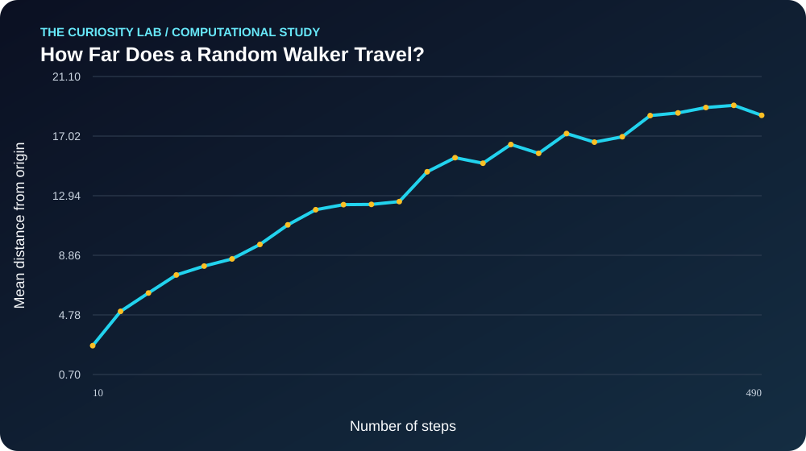

# How Far Does a Random Walker Travel?



**Field:** Computer Science  
**Date:** 2026-11-02  
**Type:** Reproducible computational demonstration

## The big question

> How does displacement grow with random-walk length?

## Why this is interesting

Independent random steps yield diffusive scaling.

The experiment explores how a mathematical or algorithmic assumption
shapes the results. It is intended to inspire deeper investigation,
not to claim a new scientific discovery.

## What I built

- A working Python model or algorithm
- A deterministic computational experiment
- A CSV dataset containing 25 evaluated observations
- A custom SVG visualization
- A reproducibility check and automated tests

## Method

- Simulated 120 independent 2D random walks per step count.

The experiment uses random seed `205792737402671`.

All observations are synthetic or algorithmically generated.
No human participant data were collected.

## Results

| Metric | Value |
|---|---:|
| Observations | 25 |
| First output | 2.67885 |
| Last output | 18.44452 |
| Mean output | 13.19931 |
| Output range | 16.45135 |
| Endpoint slope | 0.03285 |

Across the evaluated range, the output **increased**.

This is a property of this particular model and parameter setting,
not evidence that all real-world systems behave the same way.

## Reproduce it

```bash
python3 reproduce.py
python3 -m unittest discover -s tests -v
```

## What this does NOT prove

- It does not establish causality.
- It does not validate the model against real-world data.
- It does not demonstrate a new scientific discovery.
- Its conclusions are limited to the implemented assumptions.

## Where to go next

1. Change a model assumption and compare the resulting curve.
2. Add uncertainty estimates or sensitivity analysis.
3. Find an appropriate openly licensed empirical dataset.
4. Compare this method with a competing algorithm.
5. Explain what would falsify the model's predictions.

## Project files

- `model.py` — self-contained computational experiment
- `data.csv` — generated observations
- `visualization.svg` — custom data visualization
- `reproduce.py` — checks reproducibility
- `tests/` — automated consistency checks

*Generated computationally by The Curiosity Lab.
Human review and independent empirical validation are encouraged.*
